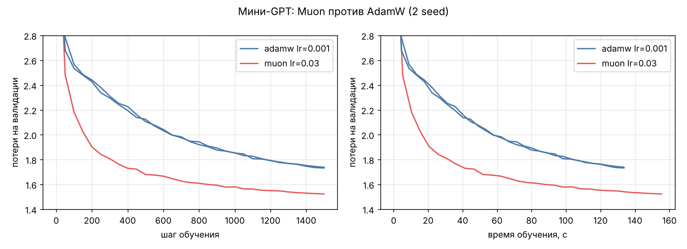

# Что тратит время при обучении нейросети и что с этим можно сделать

Небольшое экспериментальное исследование на CPU (4 ядра Xeon с AVX-512 и AMX, без GPU, PyTorch 2.15).
Все модели маленькие, поэтому выводы — гипотезы для проверки на большом масштабе, а не доказательства.

Модели: MLP 784-1024-1024-10 (MNIST, 1,86 млн параметров), мини-ResNet (MNIST, 0,31 млн),
посимвольный мини-GPT (4 слоя, d=128, контекст 128, 0,82 млн, tiny-shakespeare).

## Итог в пяти строках

1. Обратный проход стоит вдвое дороже прямого (63–64% шага в свёрточной сети и трансформере).
2. Матричные умножения — только половина шага трансформера; в MLP 40% шага съедает сам AdamW.
3. Muon вместо AdamW на мини-GPT даёт то же качество примерно втрое быстрее по реальному времени.
4. Удешевить Muon можно только сокращением итераций с 5 до 3; тёплый старт и ленивый пересчёт не работают.
5. Прореженный обратный проход не окупается ни под AdamW, ни под Muon; Muon страдает от него сильнее.

## 1. Профиль шага обучения (`profile_train.py`, torch.profiler)

| Модель | Шаг | Прямой | Обратный | Оптимизатор | Главные потребители (self CPU time) |
|---|---|---|---|---|---|
| MLP | 7,7 мс | 23% | 34% | 40% | матричные умножения 44%, поэлементные операции AdamW 40% |
| Мини-ResNet | 136 мс | 35% | 63% | 2% | свёртки 69% (обратная свёртка 47%), BatchNorm 15% |
| Мини-GPT | 89 мс | 30% | 64% | 5% | матричные умножения 50%, внимание 19%, GELU 8% |

Подготовка батча и loss — меньше 3% везде. Полные данные: `results/profile.json`.

## 2. Muon против AdamW (`muon_exp.py`, `analyze_muon.py`)

Muon применён к двумерным весам блоков, остальное на AdamW. Шаг обучения подобран для обоих
(AdamW: 3e-4…6e-3, Muon: 0,01…0,1), линейное затухание, без weight decay.

Мини-GPT, 1500 шагов, 2 seed:

| | Потери на валидации | Время шага | До потерь 2,0 | До потерь 1,8 |
|---|---|---|---|---|
| AdamW 1e-3 | 1,73 / 1,74 | 89 мс | 58 с | 107 с |
| Muon 0,03 | 1,52 / 1,51 | 104 мс | 21 с | 31–36 с |



На MLP картина обратная: Muon чуть лучше по шагам (потери 0,045–0,053 против 0,058–0,060 за 1000 шагов),
но шаг стоит 34–38 мс против 5,7 мс, и по времени он проигрывает.

Оговорки: AdamW без разогрева шага; лучший шаг AdamW в подборе — 2e-3 (2,19 против 2,22 у 1e-3 за 500 шагов),
длинные прогоны сделаны с 1e-3.

## 3. Удешевление ортогонализации в Muon (`fast_muon.py`, `fast_muon_exp.py`)

| Вариант | MLP: шаг | MLP: потери (seed 0 / 1) | GPT: потери за 500 шагов |
|---|---|---|---|
| 5 итераций (обычный) | 38 мс | 0,0445 / 0,0526 | 1,644 |
| 3 итерации | 25 мс | 0,0468 / 0,0529 | 1,663 |
| 2 итерации | 19 мс | 0,0544 / 0,0573 | 1,784 |
| Ленивый пересчёт раз в 4 шага | 15 мс | 0,0649 / 0,0711 | 2,571 |
| Ленивый пересчёт раз в 16 шагов | 9 мс | 0,0836 / 0,0815 | — |
| Тёплый старт | 45 мс | как у обычного | как у обычного |

* Три итерации — единственный вариант без заметной потери качества.
* Тёплый старт (перенос множителя S ≈ (MᵀM)^(-1/2) с прошлого шага) не сработал ни разу: импульс плохо
  обусловлен. У GPT сингулярные числа M·S_prev лежат в диапазоне 0,1–4, у MLP импульс вырожден
  (эффективный ранг ~500 из 1024), и защита каждый раз уходит в полный пересчёт.
* Ленивый пересчёт даёт обновления с сингулярными числами до 200+ и портит обучение.
* Время шага GPT в этой серии не приводится: один из замеров был испорчен параллельным запуском.

## 4. 16-битная арифметика (bfloat16)

Процессор поддерживает AMX: умножение матриц 1024×1024 в bfloat16 идёт 1,6 мс против 6,9 мс в float32.
Встроенный Muon этим пользуется. Для всей модели (`AMP=1 python3 muon_exp.py ...`):

| | float32 | bfloat16 | Потери |
|---|---|---|---|
| MLP + AdamW | 5,7 мс | 4,9 мс | без изменений |
| Мини-GPT + AdamW | 89 мс | 95 мс | без изменений |

На матрицах размера 128 преобразования форматов съедают выигрыш; на больших матрицах он должен расти.

## 5. Прореженный обратный проход (`sampled_exp.py`)

Градиент весов линейных слоёв блоков оценивается по случайной доле батча (своей для каждого слоя),
градиент по входу считается честно. Бюджет — 45 с обучения на вариант, мини-GPT, 2 seed.
Гипотеза была, что Muon терпит это лучше AdamW. Она не подтвердилась.

| Вариант | AdamW: потери | Muon: потери |
|---|---|---|
| Батч 32, полный градиент | 2,17 / 2,23 | 1,65 / 1,67 |
| Батч 32, градиент весов по 1/4 | 2,28 / 2,32 | 1,82 / 1,82 |
| Батч 32, градиент весов по 1/8 | 2,35 / 2,37 | 1,92 / 1,91 |
| Батч 16 (контроль) | 2,04 / 2,03 | 1,67 / 1,67 |
| Батч 8 (контроль) | 1,92 / 1,98 | 1,73 / 1,72 |

* Шаг от прореживания дешевеет всего на 1–5%, а качество падает: у Muon на 0,16–0,26, у AdamW на 0,09–0,18.
* Это согласуется с теорией: ортогонализация усиливает шум в направлениях с малыми сингулярными числами.
* Побочный результат: при равном времени AdamW выгоднее малый батч (8 лучше 32), а Muon — большой (32 и 16 лучше 8).
  Шаг обучения при этом подбирался только для батча 32.

## Связанные работы

Идеи разделов 3 и 5 по отдельности уже изучены: Low-rank Muon (arXiv 2509.24320), Dion (2504.05295),
Gram Newton-Schulz, анализ неточной ортогонализации (2510.19933), прореживание градиента весов по токенам
VCAS (2402.17227), шум и Muon (2606.08388, 2606.03899). Связки «прореженный обратный проход + Muon» в
поиске не нашлось; наш результат по ней отрицательный.

## Воспроизведение

```
pip install torch matplotlib
./fetch_data.sh
python3 profile_train.py          # раздел 1
./run_muon.sh && python3 analyze_muon.py   # раздел 2
./run_fast.sh                     # разделы 3 и 4
./run_sampled.sh                  # раздел 5
```

Время шага на общей машине шумит на 5–10%, запускать серии нужно по одной.
